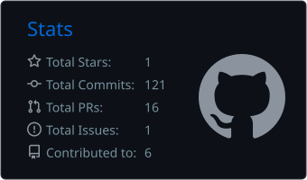
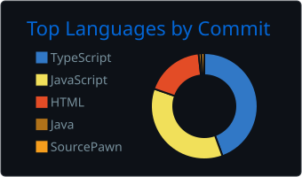
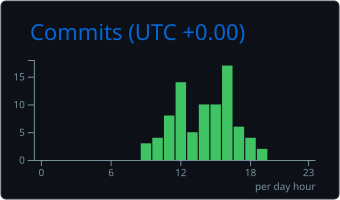

  
  

---

## 🚀 My Projects

<table>
  <tr>
    <td width="33%" valign="top" align="center">
      <h3>🏒 Advancement Calculator</h3>
      
Play out every scenario and see which teams advance to the playoffs at the Ice Hockey World Championships and other leagues.

      
    </td>
    <td width="33%" valign="top" align="center">
      <h3>🌾 channelpoints.farm</h3>
      
A tool for farming channel points automatically, without having to babysit the stream.

      
    </td>
    <td width="33%" valign="top" align="center">
      <h3>🎮 Steam Account Helper</h3>
      
A helper tool that makes managing Steam accounts simpler and faster.

      
    </td>
  </tr>
</table>

## 📊 GitHub Stats

  
  
  

---

  <i>Always building something new ✨</i>

